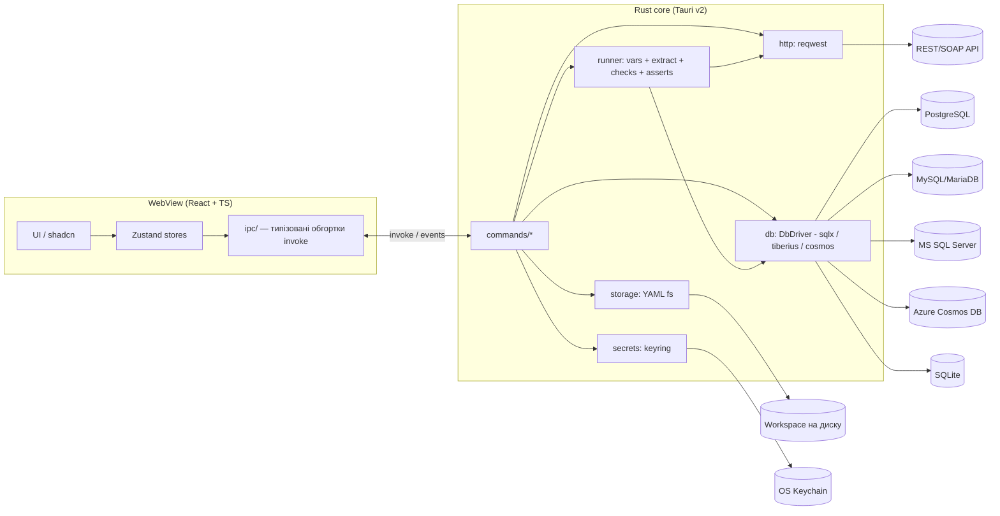

# 01. Архітектура та технічний дизайн

## 1.1 Загальна схема



Принцип: **UI нічого не виконує сам** — лише редагує модель і викликає команди. Уся логіка виконання (HTTP, SQL, змінні, асерти) — у Rust. Це дозволить у майбутньому випустити CLI (`api-pulse run collection/`) для CI без UI.

## 1.2 Стек і бібліотеки

### Frontend
| Призначення | Бібліотека |
|-------------|-----------|
| Збірка | Vite 5, TypeScript 5 (strict) |
| UI | React 18, Tailwind CSS, shadcn/ui (Radix), lucide-react |
| Стан | Zustand (+ `immer` middleware) |
| Редактор коду | CodeMirror 6 (`@codemirror/lang-json`, `lang-xml`, `lang-sql`, `lang-html`) |
| Таблиці | `@tanstack/react-table` + `@tanstack/react-virtual` (віртуалізація для великих результатів SQL) |
| Розмітка панелей | `react-resizable-panels` (входить у shadcn `Resizable`) |
| Валідація форм | `zod` (+ `react-hook-form` для модалок) |
| Тести | Vitest, React Testing Library |

### Rust (`src-tauri`)
| Призначення | Crate |
|-------------|-------|
| Каркас | `tauri` 2.x, `tauri-plugin-dialog`, `tauri-plugin-fs`, `tauri-plugin-shell` (відкриття посилань), `tauri-plugin-updater` (post-MVP) |
| Async | `tokio` (full), `tokio-util` (`CancellationToken`) |
| HTTP | `reqwest` (features: `rustls-tls`, `cookies`, `gzip`, `brotli`, `deflate`, `multipart`, `stream`, `socks`) |
| БД: Postgres / MySQL / SQLite | `sqlx` (features: `runtime-tokio`, `tls-rustls`, `postgres`, `mysql`, `sqlite`, `chrono`, `uuid`, `json`, `rust_decimal`) |
| БД: MS SQL Server | `tiberius` (features: `rustls`, `chrono`, `rust_decimal`, `tds73`) + `bb8-tiberius` (пул) + `tokio-util::compat` |
| БД: Azure Cosmos DB (NoSQL API) | `azure_data_cosmos` (офіційний Azure SDK for Rust, preview) + `azure_identity` (Entra ID: Azure CLI / DefaultAzureCredential); fallback — прямі виклики REST API через `reqwest` з HMAC-підписом account key, якщо SDK буде нестабільним |
| SQL-спліттинг / аналіз | `sqlparser` (діалекти PG/MySQL/MsSql/SQLite — розбиття на statements, визначення read/write) |
| JSON Schema / XSD валідація | `jsonschema`; XSD — власний піднабір поверх моделі WSDL-парсера (зрілих Rust-бібліотек XSD немає; `libxml` — альтернатива з C-залежністю) |
| Серіалізація | `serde`, `serde_json`, `serde_yaml` (або `serde_yml`) |
| JSONPath | `serde_json_path` (RFC 9535) |
| XML / XPath | `quick-xml` (форматування/парсинг), `sxd-document` + `sxd-xpath` (XPath 1.0) |
| Regex | `regex` |
| Секрети | `keyring` |
| Помилки / логування | `thiserror`, `tracing`, `tracing-subscriber`, `tracing-appender` |
| Ідентифікатори | `uuid` (v7 — сортовані за часом) |
| Тести | `cargo test`, `testcontainers` (Postgres/MySQL), `wiremock` (HTTP mock) |

## 1.3 Структура репозиторію

```
api-pulse/
├─ docs/
├─ src/                              # Frontend
│  ├─ main.tsx, App.tsx
│  ├─ components/ui/                 # shadcn (генеровані)
│  ├─ components/common/             # KeyValueTable, CodeEditor, StatusBadge, EmptyState...
│  ├─ features/
│  │  ├─ layout/                     # AppShell, Sidebar, TabBar, StatusBar
│  │  ├─ collections/                # дерево, CRUD, drag&drop, import/export
│  │  ├─ request/                    # RequestEditor, UrlBar, Params/Headers/Auth/Body
│  │  ├─ soap/                       # SoapEditor, WSDL-імпорт, envelope builder
│  │  ├─ response/                   # ResponseViewer, Pretty/Raw/Preview, Timeline
│  │  ├─ environments/               # EnvironmentEditor, селектор оточення
│  │  ├─ db/                         # ConnectionDialog, SqlRunner, SchemaTree, ResultGrid
│  │  ├─ assertions/                 # AssertionBuilder, ExtractorBuilder, DbCheckBuilder, TestResults
│  │  ├─ history/
│  │  └─ settings/
│  ├─ stores/                        # workspaceStore, tabsStore, envStore, dbStore, settingsStore, historyStore
│  ├─ ipc/                           # commands.ts (обгортки invoke), events.ts, types.ts (генеровані)
│  ├─ lib/                           # utils, variable-highlighter, formatters
│  └─ styles/globals.css
├─ src-tauri/
│  ├─ Cargo.toml, tauri.conf.json
│  ├─ capabilities/default.json      # мінімальні дозволи Tauri v2
│  └─ src/
│     ├─ main.rs, lib.rs             # реєстрація команд і state
│     ├─ error.rs                    # AppError
│     ├─ state.rs                    # AppState (пули БД, токени скасування, workspace path)
│     ├─ commands/                   # тонкий шар: http.rs, db.rs, storage.rs, secrets.rs, runner.rs, settings.rs
│     ├─ http/                       # client.rs, builder.rs, timing.rs, soap.rs
│     ├─ db/                         # driver.rs (trait DbDriver), pool_manager.rs, value.rs, params.rs, guard.rs (read/write)
│     │  ├─ sqlx_driver.rs           # Postgres, MySQL/MariaDB, SQLite
│     │  ├─ mssql_driver.rs          # tiberius
│     │  └─ cosmos_driver.rs         # azure_data_cosmos
│     ├─ storage/                    # workspace.rs, collection.rs, environment.rs, migrate.rs, export.rs
│     ├─ vars/                       # resolver.rs, dynamic.rs
│     ├─ runner/                     # pipeline.rs, scenario.rs, steps/, extract.rs, assert.rs, compare.rs, report.rs
│     └─ model/                      # серде-типи (джерело правди для TS-типів)
├─ e2e/                              # WebdriverIO + tauri-driver
└─ .github/workflows/                # ci.yml, release.yml
```

Генерація TS-типів з Rust: `ts-rs` або `specta` + `tauri-specta` — **обов'язково**, щоб контракт IPC не розходився. Рекомендовано `tauri-specta` (генерує і типи, і типізовані функції команд).

## 1.4 IPC-контракт (Tauri commands)

Усі команди повертають `Result<T, AppError>`.

```ts
type AppError = {
  code: 'IO' | 'PARSE' | 'VALIDATION' | 'HTTP' | 'TIMEOUT' | 'CANCELLED'
      | 'DB_CONNECT' | 'DB_QUERY' | 'SECRET' | 'NOT_FOUND' | 'INTERNAL';
  message: string;          // людиночитне
  details?: string;         // технічні деталі (stack/драйвер)
};
```

### Workspace / Storage
| Команда | Вхід | Вихід |
|---------|------|-------|
| `workspace_open` | `{ path }` | `WorkspaceTree` |
| `workspace_create` | `{ path, name }` | `WorkspaceTree` |
| `collection_create` / `_rename` / `_delete` | `{ ... }` | `CollectionNode` |
| `folder_create` / `_rename` / `_delete` / `_move` | | `FolderNode` |
| `request_get` | `{ id }` | `RequestDef` |
| `request_save` | `{ request: RequestDef }` | `void` |
| `request_create` / `_duplicate` / `_move` / `_delete` | | `RequestNode` |
| `environment_list` / `_save` / `_delete` | | `Environment[]` |
| `export_collection` | `{ collectionId, format: 'json'\|'yaml', targetPath, includeSecrets: false }` | `void` |
| `import_collection` | `{ sourcePath, kind: 'apipulse'\|'postman_v2_1'\|'wsdl' }` | `ImportReport` |

Подія `workspace://changed` — від file watcher (`notify` crate), щоб підхоплювати зовнішні зміни (git pull).

### HTTP
| Команда | Вхід | Вихід |
|---------|------|-------|
| `http_send` | `{ execId, request: ResolvedRequest, options }` | `HttpResponse` |
| `http_cancel` | `{ execId }` | `void` |

```ts
type HttpResponse = {
  status: number; statusText: string;
  headers: [string, string][];          // масив, бо заголовки можуть повторюватися
  cookies: Cookie[];
  body: { kind: 'text'; text: string } | { kind: 'binary'; base64: string; truncated: boolean };
  contentType?: string;
  sizeBytes: { headers: number; body: number };
  timings: { dnsMs?: number; connectMs?: number; tlsMs?: number; ttfbMs: number; downloadMs: number; totalMs: number };
  httpVersion: string;
  remoteAddr?: string;
};
```

Примітка по таймінгах: `reqwest` не віддає DNS/TLS окремо. MVP — `ttfbMs` (до отримання заголовків), `downloadMs`, `totalMs`. Детальні фази — post-MVP через кастомний `dns_resolver` і `hyper` connector.

### DB
| Команда | Вхід | Вихід |
|---------|------|-------|
| `db_test_connection` | `{ profile }` | `{ ok, serverVersion, latencyMs }` |
| `db_connect` / `db_disconnect` | `{ profileId }` | `void` |
| `db_list_schemas` / `db_list_tables` / `db_describe_table` | | метадані |
| `db_execute` | `{ execId, profileId, query: DbQuery, mode: 'check' \| 'setup', maxRows, timeoutMs }` | `QueryResult[]` |
| `db_cancel` | `{ execId }` | `void` |

```ts
type QueryResult = {
  columns: { name: string; dbType: string }[];
  rows: CellValue[][];           // типізовані значення
  rowsAffected?: number;
  truncated: boolean;            // перевищено maxRows
  elapsedMs: number;
};
type CellValue = null | boolean | number | string | { $type: 'decimal' | 'datetime' | 'bytes' | 'json' | 'uuid'; value: string };
```

Кожен драйвер повертає значення зі своїми типами — у `db/value.rs` нормалізувати в `CellValue` (decimal/bigint > 2^53 → рядок, щоб не втратити точність у JS; MSSQL `uniqueidentifier` → uuid, `datetime2`/`datetimeoffset` → datetime, `money` → decimal; Cosmos — JSON-документи як є, системні поля `_rid`, `_self`, `_etag`, `_attachments`, `_ts` приховані за замовчуванням).

```rust
#[async_trait]
pub trait DbDriver: Send + Sync {
    async fn test(&self) -> Result<ServerInfo, AppError>;
    async fn execute(&self, q: DbQuery, mode: ExecMode, cancel: CancellationToken) -> Result<Vec<QueryResult>, AppError>;
    async fn schema(&self, scope: SchemaScope) -> Result<SchemaNode, AppError>;
}
pub enum DbQuery {
    Sql { text: String, params: Vec<(String, Value)> },
    Cosmos { database: Option<String>, container: String, op: CosmosOp },
}
pub enum CosmosOp {
    Query { sql: String, params: Vec<(String, Value)>, partition_key: Option<Value>, max_items: u32 },
    Read { id: String, partition_key: Value },
    Upsert { item: Value, partition_key: Option<Value> },
    Delete { id: String, partition_key: Value },
}
pub enum ExecMode { Check, Setup }
```

Результат Cosmos нормалізується до того ж `QueryResult`: документ = рядок, колонки = об'єднання ключів верхнього рівня, вкладені об'єкти — `json`-клітинки; додатково `requestCharge` (RU). Завдяки цьому асерти `rows[0].field` працюють однаково для SQL і NoSQL.

**Ключ пулу — хеш *резолвлених* параметрів підключення, а не `profileId`.** У SoapUI-проєктах команди хост БД оператора визначається під час тесту запитом до каталогу (`Catalog → DataSource.Host`), тобто один профіль з `host: "{{DataBaseHost}}"` може вести на різні сервери в межах одного запуску (07-soapui-analysis §7.3).

### Runner
| Команда | Вхід | Вихід |
|---------|------|-------|
| `run_request` | `{ execId, requestId \| requestDef, environmentId }` | `RunResult` (див. 04-assertions.md) |
| `run_scenario` | `{ execId, scenarioId, environmentId, options }` | `ScenarioResult`; прогрес подіями `runner://step` |
| `run_suite` | `{ execId, suiteId \| scenarioIds[], environmentId, stopOnFail }` | `SuiteResult`; події `runner://scenario`, `runner://step` |
| `run_step` | `{ execId, scenarioId, stepId, environmentId }` | `StepResult` (дебаг одного кроку з поточними змінними) |
| `run_cancel` | `{ execId }` | `void` (Teardown все одно виконується) |

### Secrets
| Команда | Вхід | Вихід |
|---------|------|-------|
| `secret_set` | `{ key, value }` | `void` |
| `secret_get` | `{ key }` | `string \| null` |
| `secret_delete` | `{ key }` | `void` |

Ключ: `api-pulse/<workspaceId>/<scope>/<name>`.

## 1.5 Стан у Rust (`AppState`)

```rust
pub struct AppState {
    pub workspace: RwLock<Option<Workspace>>,
    pub db_pools: Mutex<HashMap<ProfileId, PoolEntry>>,   // AnyPool + last_used
    pub inflight: Mutex<HashMap<ExecId, CancellationToken>>,
    pub http_client: reqwest::Client,                     // базовий; per-request клієнт якщо змінені TLS/proxy
    pub runtime_vars: RwLock<HashMap<String, Value>>,     // змінні, записані екстракторами
}
```

- Пули БД: `max_connections = 3`, idle-закриття після 10 хв (фонова задача).
- Скасування: кожна команда отримує `execId` з UI, реєструє `CancellationToken`, виконує через `tokio::select!`.

## 1.6 Безпека

1. **Tauri capabilities** — дозволити лише потрібні плагіни; `fs` обмежити scope робочою папкою та app-data.
2. **CSP** у `tauri.conf.json`: `default-src 'self'; style-src 'self' 'unsafe-inline'; img-src 'self' data: blob:`.
3. **HTML Preview** відповіді — тільки в `<iframe sandbox>` (без `allow-scripts`) через `srcdoc`.
4. **Секрети** не пишуться в YAML, логи, історію; у логах маскування заголовків `Authorization`, `Cookie`, `X-Api-Key`, полів `password`.
5. **SQL-параметри** — тільки bind-параметри (ADR-07). Захист від запису (ADR-09) у режимі `check` — багатошаровий:
   - статичний аналіз (`sqlparser`): дозволені лише `SELECT`/`WITH ... SELECT`/`SHOW`/`EXPLAIN`;
   - сесія/транзакція: Postgres `SET TRANSACTION READ ONLY`; MySQL `START TRANSACTION READ ONLY`; SQLite `?mode=ro`; MSSQL — виконання в `BEGIN TRAN ... ROLLBACK` (у MSSQL немає read-only сесії);
   - Cosmos: у `check` дозволені лише `Query` (Cosmos SQL — за визначенням read-only) і `Read`; для перевірок рекомендовано read-only key або Entra-роль `Cosmos DB Built-in Data Reader`;
   - профіль `protected: true` забороняє `setup`-кроки повністю;
   - рекомендація в документації: окремий DB-користувач з правами лише на читання для перевірок (єдиний 100% надійний спосіб).
6. **TLS**: за замовчуванням перевірка сертифікатів увімкнена; вимкнення — явний чекбокс на запит/колекцію з попередженням у UI.
7. **XML**: парсер без підтримки зовнішніх сутностей (XXE) — `quick-xml` їх не розкриває за замовчуванням, перевірити тестом.
8. Без телеметрії; без мережевих запитів, крім ініційованих користувачем (і updater — post-MVP, opt-in).

## 1.7 Нефункціональні вимоги (вимірювані)

| Метрика | Ціль | Як міряти |
|---------|------|-----------|
| Розмір інсталятора | < 20 MB (Win .msi) | артефакт CI |
| RAM у простої | < 150 MB (сумарно процес + WebView) | Task Manager / `ps`, 5 відкритих вкладок |
| Холодний старт | < 1.5 c до інтерактивного UI | `performance.now()` + лог Rust |
| Відкриття workspace з 1000 запитів | < 1 c | бенчмарк `storage` |
| Відображення JSON 5 MB | без фрізу UI > 100 мс | форматування у Rust, віртуалізація/ліміт підсвітки |
| SQL результат 100k рядків | плавний скрол | `maxRows` за замовчуванням 1000, віртуалізація |
