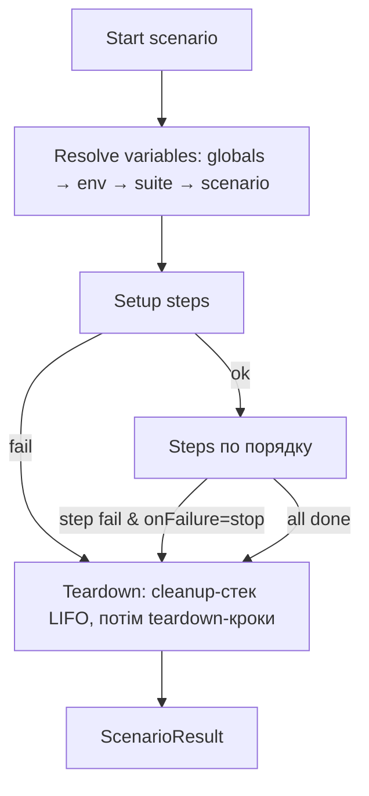

# 06. Сценарії (Test Suites / Test Cases)

## 6.1 Концепція

Сценарій — це тест-кейс з упорядкованих кроків. Модель SoapUI, але плоска й без Groovy:

| SoapUI | API-Pulse |
|--------|-----------|
| Project | Workspace |
| Interface / Operation / Request | Collection / Folder / Request |
| TestSuite | Suite (папка в `scenarios/`) |
| TestCase | Scenario (`*.scenario.yaml`) |
| TestStep (SOAP/REST Request, JDBC, Delay, Properties, Property Transfer, Manual) | Step (Request, SQL, Cosmos, Delay, Set Variables, Extract у кроці, Manual) |
| TestSuite / Project properties | Змінні suite / environment (спільні між сценаріями suite, див. §6.4 п.9) |
| Setup / TearDown Script (Groovy) | Секції `setup` / `teardown` з тих самих типів кроків |
| Assertions | Асерти на кожному кроці (04-assertions.md) |

Принцип: **Requests — бібліотека, Scenarios — тести.** Запит з колекції підключається в сценарій за `requestId` і може мати в сценарії власні екстрактори/асерти (поверх асертів самого запиту).

## 6.2 Типи кроків

| Kind | Призначення | Ключові поля |
|------|-------------|--------------|
| `request` | REST/SOAP-запит з колекції або вбудований | `requestId` або `inline: RequestDef`, `overrides` (url/headers/body частково), `extract`, `assertions`, `useRequestAssertions: true` |
| `sql` | Сетап або перевірка в SQL-БД | `connectionId`, `mode: setup \| check`, `sql` або `file`, `params`, `extract`, `assertions`, `retry`, `cleanup` |
| `cosmos` | Те саме для Azure Cosmos DB | `connectionId`, `mode`, `cosmos: { container, partitionKey, query \| operation: read/upsert/delete, item }`, `params` |
| `manual` | Ручний крок (є в SoapUI-проєктах команди): інструкція для тестувальника, запуск стає на паузу до вибору Pass / Fail | `description`, `expectedResult` |
| `setVariables` | Задати/обчислити змінні | `variables: [{ key, value }]` (шаблони, динамічні змінні) |
| `delay` | Пауза | `ms` |
| `assert` | Окремі асерти над змінними/результатами попередніх кроків | `assertions` |

Кожен крок має: `id`, `name` (унікальний у сценарії, `[A-Za-z_][A-Za-z0-9_]*`), `enabled`, `onFailure: stop | continue` (за замовчуванням `stop`), `timeoutMs`.

## 6.3 Формат файлів

`scenarios/orders/_suite.yaml`:
```yaml
schemaVersion: 1
id: 0192...s1
name: Orders
order: 0
variables:
  - { key: currency, value: UAH }
runMode: sequential   # sequential | independent
setup: []        # виконується один раз перед усіма сценаріями suite
teardown: []
```

`scenarios/orders/create-order.scenario.yaml`:
```yaml
schemaVersion: 1
id: 0192...t1
name: Create order for new user
tags: [smoke, orders]
order: 0
variables:
  - { key: email, value: "qa_{{$randomString(8)}}@example.test" }
options:
  timeoutMs: 120000

setup:
  - id: 0192...1
    kind: sql
    name: seedUser
    connectionId: 0192...c1
    mode: setup
    sql: |
      INSERT INTO users (email, status)
      VALUES (:email, 'active')
      RETURNING id
    params:
      - { name: email, value: "{{email}}" }
    extract:
      - { variable: userId, source: { kind: dbCheck, check: seedUser, path: "rows[0].id" } }
    cleanup:
      sql: DELETE FROM users WHERE id = :userId
      params: [ { name: userId, value: "{{userId}}" } ]

steps:
  - id: 0192...2
    kind: request
    name: createOrder
    requestId: 0192...b9
    overrides:
      body:
        raw: |
          { "userId": {{userId}}, "currency": "{{currency}}", "items": [ { "sku": "A1", "qty": 2 } ] }
    extract:
      - { variable: orderId, source: { kind: jsonBody, path: "$.id" } }
    assertions:
      - { actual: { kind: status }, operator: eq, expected: { kind: literal, value: 201 } }

  - id: 0192...3
    kind: sql
    name: orderRow
    connectionId: 0192...c1
    mode: check
    sql: SELECT id, user_id, status, total FROM orders WHERE id = :orderId
    params: [ { name: orderId, value: "{{orderId}}" } ]
    retry: { attempts: 5, intervalMs: 500 }
    assertions:
      - { actual: { kind: dbCheck, check: orderRow, path: rowCount }, operator: eq, expected: { kind: literal, value: 1 } }
      - { actual: { kind: dbCheck, check: orderRow, path: "rows[0].status" }, operator: eq, expected: { kind: literal, value: NEW } }
      - type: rowMatchesObject
        api: { kind: step, step: createOrder, source: { kind: jsonBody, path: "$" } }
        db: { check: orderRow, row: 0 }
        mapping: { auto: snakeCase }

teardown:
  - id: 0192...4
    kind: sql
    name: deleteOrder
    connectionId: 0192...c1
    mode: setup
    sql: DELETE FROM orders WHERE id = :orderId
    params: [ { name: orderId, value: "{{orderId}}" } ]
    onFailure: continue
```

`ValueRef` розширюється видом `step` для доступу до результату будь-якого попереднього кроку:
```yaml
{ kind: step, step: createOrder, source: { kind: jsonBody, path: "$.id" } }
{ kind: step, step: createOrder, source: { kind: header, name: Location } }
{ kind: step, step: orderRow,    source: { kind: dbCheck, path: "rows[0].total" } }
```
У межах SQL/Cosmos-кроку `kind: dbCheck` без `check` посилається на поточний крок.

## 6.4 Семантика виконання



1. **Змінні сценарію ізольовані**: кожен запуск отримує свій runtime-scope; екстрактори пишуть у нього. Запис в оточення (`scope: environment`) — лише явно.
2. **Setup впав** → Steps не виконуються (статус `SKIPPED`), сценарій `ERROR`, Teardown виконується.
3. **Teardown виконується завжди**: при FAILED, ERROR, скасуванні користувачем і таймауті сценарію. Помилки в Teardown показуються, але не змінюють статус тесту з PASSED на FAILED (окремий прапорець `teardownErrors`).
4. **Cleanup-стек**: SQL/Cosmos-крок з `cleanup` реєструє відкат **лише якщо сам крок пройшов успішно**. У Teardown стек виконується у зворотному порядку (LIFO) перед явними teardown-кроками. Так дані прибираються навіть якщо сценарій упав посередині, і без дублювання логіки.
5. **Retry** для `check`-кроків: повтор, доки всі асерти кроку не пройдуть або не вичерпано спроби (eventual consistency, черги).
6. **`mode: setup`** заборонений для `protected`-профілів (валідація при збереженні і при запуску). **`mode: check`** — захист від запису з 01-architecture §1.6.
7. **Транзакції**: кожен SQL-крок — окрема автокомітна транзакція (API бачить сетап-дані лише після коміту). Опція `transaction: wrap` для кількох statements у кроці.
8. **Скасування**: поточний крок переривається, далі Teardown.
9. **Suite-рівень і спільні змінні.** У SoapUI-проєктах команди найчастіший тип змінних — TestSuite properties (3518 використань): перший TestCase готує дані з БД і кладе їх у suite, наступні їх використовують. Тому:
   - екстрактор має `scope: suite` — значення живе до кінця запуску suite і видиме всім наступним сценаріям;
   - сценарії suite виконуються строго за `order`; `_suite.yaml` має `runMode: sequential | independent` (для independent сценарії не бачать suite-записів один одного);
   - сценарій може мати `dependsOn: [scenarioId]` — при запуску одного сценарію з дерева залежності запускаються спочатку (або беруться останні suite-значення з кешу — кнопка «Use cached suite variables»);
   - `_suite.yaml` `setup` виконується один раз перед сценаріями, `teardown` — після всіх.
10. **Режими запуску з ручними кроками**: у UI — пауза з діалогом; у майбутньому CLI — `SKIPPED`.

## 6.5 Data-driven (Should)

```yaml
dataSource:
  kind: csv                     # csv | json | sql
  file: ./data/orders.csv       # для sql: connectionId + sql
  iterationName: "{{sku}} × {{qty}}"
```
Кожен рядок джерела → окрема ітерація з колонками як змінними. Для `sql`-джерела тести генеруються з реальних даних БД — цього немає в Postman/Bruno. У звіті — окремий результат на ітерацію.

## 6.6 UI

### Sidebar «Scenarios»
```
Scenarios                        [+][▶ Run all]
🔍 filter…   tags: [smoke ✕]
▾ Orders                    ✔ 4/5
   ✔ Create order for new user   1.2s
   ✘ Cancel order                0.8s
   ○ Refund order
▸ Users
```
- Дерево Suite → Scenario, статус останнього запуску, фільтр за тегами.
- ПКМ: Run, Run with environment…, Duplicate, Rename, Delete, Export.

### Scenario Editor (вкладка)
```
┌ Create order for new user ───────────────────────── Env: [dev ▾] [▶ Run] [■] ┐
│ STEPS                          │ createOrder · Request                       │
│ ▾ Setup                        │ Request: Orders API / Create order  [Open ↗]│
│   ✔ 1 SQL  seedUser   12ms     │ Overrides | Extract(1) | Asserts(1) | Result │
│ ▾ Steps                        │ ...редактор вибраного кроку...              │
│   ✔ 2 POST createOrder 182ms   │                                             │
│   ✘ 3 SQL  orderRow   3 tries  │                                             │
│   [+ Add step ▾]               │                                             │
│ ▾ Teardown                     │                                             │
│   ✔ ↺ cleanup seedUser         │                                             │
│   ✔ 4 SQL  deleteOrder         │                                             │
├────────────────────────────────┴─────────────────────────────────────────────┤
│ Variables: userId=42 · orderId=1007 · email=qa_x1y2@example.test     [👁 all]  │
└──────────────────────────────────────────────────────────────────────────────┘
```
- Ліворуч список кроків з drag & drop між секціями, праворуч — редактор кроку (той самий `RequestEditor`/`DbCheckCard`/`AssertionRow`, що й у запитах).
- **Перетягування запиту з Collections у список кроків** створює `request`-крок.
- Дії на кроці: `▶ Run step` (з поточними змінними сценарію — для налагодження), `▶ Run from here`, `Disable`, `Duplicate`.
- Під час запуску: живий прогрес через події `runner://step`, поточний крок підсвічений, змінні оновлюються в нижній панелі.
- Вкладка `Result` кроку: для request — повний Response Viewer; для SQL — ResultGrid + асерти.

### Звіт запуску
- Вкладка «Run report»: дерево Suite → Scenario → Step з часом і статусом, фільтр «тільки failed», для кожного кроку — запит/відповідь/SQL/результат.
- Експорт HTML (Should), JUnit XML (з CLI, post-MVP).
- Історія запусків сценарію (останні 20) з порівнянням «що змінилось».

## 6.7 Модель результату

```ts
type ScenarioResult = {
  execId: string; scenarioId: string; environmentId?: string;
  status: 'PASSED' | 'FAILED' | 'ERROR' | 'CANCELLED';
  startedAt: string; totalMs: number;
  iterations?: { name: string; status: Outcome; steps: StepResult[] }[];
  setup: StepResult[]; steps: StepResult[]; teardown: StepResult[];
  teardownErrors: boolean;
  variables: Record<string, unknown>;   // фінальний runtime-scope, секрети замасковані
};
type StepResult = {
  stepId: string; name: string; kind: StepKind; status: Outcome; attempts: number; durationMs: number;
  run?: RunResult;          // для request (04-assertions §4.5.4)
  query?: QueryResult[];    // для sql/cosmos
  assertions: AssertionResult[]; extracts: ExtractResult[]; error?: AppError;
};
```

## 6.8 Відмінність від «Checks & Asserts» у запиті

DB Checks всередині запиту (04-assertions) залишаються для швидкої ручної перевірки «відправив → глянув БД». Сценарій — для повторюваних тестів з сетапом і прибиранням. Кнопка **«Convert to scenario»** на запиті створює сценарій: request-крок + його DB Checks як окремі `sql`-кроки.
